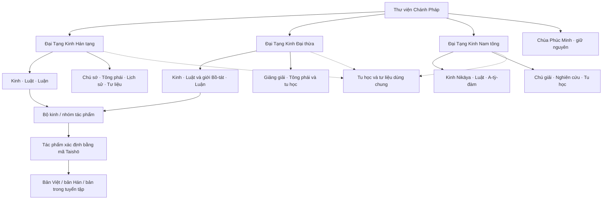

# Cấu trúc ba tạng kinh và mạng lưới tra cứu

Thư viện có ba lối vào chính: **Đại Tạng Kinh Hán tạng**, **Đại Tạng Kinh Đại thừa**, **Đại Tạng Kinh Nam tông**. Mỗi kho có cây riêng, mở dần từ nhóm đến bộ rồi tác phẩm. **Chùa Phúc Minh giữ nguyên** trang thư viện, nhóm sách, 26 tài liệu và các thao tác hiện có. Trình đọc và bộ phát âm thanh giữ nguyên.

## Cấu trúc tổng thể



Ba cây là các lối tra cứu có liên hệ với nhau. Hán tạng là một kho văn bản; Đại thừa và Nam tông là cách tổ chức nội dung theo truyền thống. Vì vậy, các tác phẩm Hán tạng có thể được tìm thấy qua cây Đại thừa bằng liên kết đến đúng bản gốc. Không sao chép tệp hoặc tạo mã sách mới.

Định hướng giữ bộ gốc, mở cây theo cấp và tạo các nhóm liên quan tham khảo [mục lục CBETA](https://archive2.cbeta.org/cbreader/help/cbeta_toc_en.htm). Cấu trúc Nam tông tham khảo [Tipiṭaka trên Access to Insight](https://www.accesstoinsight.org/tipitaka/index.html) và [hướng dẫn tra cứu kinh Pāli của SuttaCentral](https://suttacentral.net/general-guide-sujato?lang=en). Việc gom sách tu học và các liên kết trong thư viện này là lựa chọn biên tập dựa trên dữ liệu đang có.

## Cây Hán tạng: giữ đủ 25 bộ

```text
Đại Tạng Kinh Hán tạng
├── Kinh tạng
│   ├── 01. A-Hàm bộ
│   │   ├── Trường A-Hàm
│   │   ├── Trung A-Hàm
│   │   ├── Tạp A-Hàm
│   │   ├── Tăng Nhất A-Hàm
│   │   ├── Kinh liên quan khác
│   │   └── Luận giải A-Hàm
│   ├── 02. Bản Duyên bộ
│   ├── 03. Bát Nhã bộ
│   ├── 04. Pháp Hoa bộ
│   ├── 05. Hoa Nghiêm bộ
│   ├── 06. Bảo Tích bộ
│   ├── 07. Niết Bàn bộ
│   ├── 08. Đại Tập bộ
│   ├── 09. Kinh Tập bộ
│   └── 10. Mật Giáo bộ
├── Luật tạng
│   └── 11. Luật bộ
├── Luận tạng
│   ├── 12. Thích Kinh Luận bộ
│   ├── 13. Tỳ Đàm bộ
│   ├── 14. Trung Quán bộ
│   ├── 15. Du Già bộ
│   └── 16. Luận Tập bộ
├── Chú sớ
│   ├── 17. Kinh Sớ bộ
│   ├── 18. Luật Sớ bộ
│   └── 19. Luận Sớ bộ
├── Tông phái
│   └── 20. Chư Tông bộ
├── Lịch sử & truyện ký
│   └── 21. Sử Truyện bộ
├── Tư liệu & mục lục
│   ├── 22. Sự Vị bộ
│   ├── 23. Ngoại Giáo bộ
│   ├── 24. Mục Lục bộ
│   └── 25. Cổ Dật & Nghi Tợ bộ
└── Tu học & tư liệu dùng chung
```

Đây là 25 bộ của **dữ liệu thư viện hiện tại**. Cổ Dật và Nghi Tợ được ghép thành một bộ trong nguồn của thư viện. Không đổi mã bộ để ép theo một danh mục ngoài khác. Toàn bộ 2.471 bản Hán tạng vẫn ở đúng bộ gốc; 14 sách luật / nghiên cứu Hán truyền từ kho Việt ngữ được bổ sung vào các nhánh phù hợp và vẫn ghi nguồn riêng.

## Cây Đại thừa

```text
Đại Tạng Kinh Đại thừa
├── Kinh tạng
│   ├── Bát Nhã
│   ├── Pháp Hoa
│   ├── Hoa Nghiêm
│   ├── Bảo Tích
│   ├── Niết Bàn
│   ├── Đại Tập
│   ├── Kinh Tịnh độ
│   ├── Mật giáo
│   ├── Các kinh khác
│   ├── Bản duyên & kinh liên quan trong tuyển tập
│   └── Kinh sơ kỳ liên quan trong tuyển tập
├── Luật & giới Bồ-tát
│   ├── Giới Bồ-tát
│   ├── Luật Hán truyền
│   └── Giảng giải & học giới
├── Luận tạng
│   ├── Luận giải thích kinh
│   ├── Trung Quán
│   ├── Du Già / Duy thức
│   └── Các luận khác
├── Giảng giải & chú sớ
│   ├── Các nhóm tương ứng với nhóm kinh
│   └── Chú sớ Hán truyền
├── Tông phái & tu học
│   ├── Thiền tông
│   ├── Tịnh độ
│   ├── Học Duy thức
│   ├── Học Mật tông
│   ├── Tông phái Hán truyền
│   └── Giáo lý Đại thừa
└── Tu học & tư liệu dùng chung
```

Các bản có mã Taishō trong tuyển tập 62 bộ được liên kết vào đúng bộ Hán tạng. Tuyển tập có một số bản thuộc Bản Duyên hoặc A-Hàm trong danh mục nguồn; chúng giữ tên “liên quan” thay vì coi tên kho là chứng cứ để gán truyền thống. Luật Hán truyền giữ thông tin bộ phái và xuất xứ; lối liên kết trong cây Đại thừa không biến tất cả luật Hán truyền thành luật riêng của Đại thừa.

Nhóm Tịnh độ gom theo nhu cầu tra cứu. Trong cây Hán tạng, bản gốc vẫn ở Bảo Tích, Đại Tập hoặc Kinh Tập theo nguồn. Mật giáo ưu tiên bộ gốc để nhan đề chứa “Kim Cang” không bị xếp nhầm sang Bát Nhã.

## Cây Nam tông

```text
Đại Tạng Kinh Nam tông
├── Kinh tạng · Nikāya
│   ├── Trường Bộ · DN
│   ├── Trung Bộ · MN
│   ├── Tương Ưng Bộ · SN
│   ├── Tăng Chi Bộ · AN
│   ├── Tiểu Bộ · KN
│   └── Kinh lẻ & bản trích chưa xác định đủ bộ / số kinh
├── Luật tạng
│   ├── Bản luật & giới bổn
│   └── Chú giải & học giới
├── A-tỳ-đàm / Vi diệu pháp
│   ├── Bản A-tỳ-đàm
│   └── Sách học & tổng hợp
├── Chú giải & nghiên cứu
│   ├── Chú giải Pháp Cú
│   ├── Thanh Tịnh Đạo
│   ├── Mi Tiên / Milinda
│   └── Nghiên cứu & giảng giải
├── Tu học Nam tông
│   └── Thiền nguyên thủy
└── Tu học & tư liệu dùng chung
```

Nhánh trống chưa có bản trong thư viện sẽ không hiện trong danh sách. Cây mô tả nội dung hiện có, không tuyên bố thư viện chứa đầy đủ Tam tạng Pāli. Ví dụ, Thắng Pháp Tập Yếu và các tài liệu toát yếu ở nhánh sách học; Thanh Tịnh Đạo ở chú giải. Những sách Câu Xá, A-tỳ-đàm Hữu Bộ và nghiên cứu Huyền Trang nằm trong thư mục nguồn “Luận Nam tông” được điều chỉnh về Tỳ-đàm Hán truyền dựa trên nhan đề / tên tệp, có giữ xuất xứ ban đầu.

## Tư liệu dùng chung và Chùa Phúc Minh

Sách nhập môn, giáo lý, Thiền chưa rõ truyền thống, nghiên cứu Pāli–A-Hàm, lịch sử, đạo đức, nghi lễ, đời sống, văn học và tài liệu tham khảo nằm trong một nhánh dùng chung. Có thể mở nhánh này từ cả ba cây. Các bản đó có một vị trí chính và giữ nguồn riêng; không mặc định mọi sách Phật học Việt ngữ là Đại thừa.

Chùa Phúc Minh giữ lối vào riêng và không đưa 26 sách vào ba cây mới. Bộ lọc, trang chi tiết, PDF, OCR, bản đọc, nghe và các nhóm sách hiện có giữ nguyên.

## Mạng liên kết

| Liên hệ | Cách thể hiện | Giới hạn |
| --- | --- | --- |
| Cùng tác phẩm, nhiều bản | Gom bằng mã Taishō, mở “Chọn bản đọc” để chọn bản nguồn | Không gom chỉ vì nhan đề giống nhau |
| Bộ Đại thừa ↔ bộ Hán tạng | Nút “Về bộ gốc trong Hán tạng” và chiều ngược lại | Bản gốc giữ bộ / mã / tệp |
| Kinh ↔ sách giảng cùng nhóm | Nút “Giảng giải & nghiên cứu nhóm này” và chiều ngược lại | Liên hệ ở cấp nhóm, chưa khẳng định từng sách giảng đúng một bản kinh |
| A-Hàm ↔ Nikāya | Liên kết Trường–Trường, Trung–Trung, Tạp–Tương Ưng, Tăng Nhất–Tăng Chi | Đối chiếu cấp bộ; không tuyên bố mọi bài kinh tương đương từng bài |
| Luật / A-tỳ-đàm giữa các truyền thống | Liên kết tra cứu nhánh liên quan | Giữ rõ Pāli và Hán truyền |
| Một bản xuất hiện trong nhiều cây | “Nguồn & phân loại” có liên kết mở cây khác | Dùng cùng mã bản để giữ tiến độ đọc và nghe |

Chỉ mã tác phẩm đã có trong dữ liệu được dùng để gom bản. Các sách Word chưa có mã tác phẩm vẫn là mục riêng. Việc xác minh quan hệ từng bài kinh và từng bản dịch sẽ cần bổ sung bảng đối chiếu có nguồn; hệ thống hiện tại không tự suy ra quan hệ đó.

## Trải nghiệm tìm và đọc

Trang chủ và thanh bên có ba kho, sau đó là Chùa Phúc Minh. Danh mục tệp nguồn cũ nằm ở mục thu gọn “Danh mục nguồn gốc” để kiểm tra xuất xứ hoặc mở liên kết cũ.

Trên máy tính, cây danh mục bên cạnh danh sách cho phép mở từng nhánh; nhóm đang xem được đánh dấu. Trên điện thoại, nút “Cây danh mục” mở phần cây khi cần. Các cấp có đường dẫn quay lại. Nút Back của trình duyệt quay về nhánh trước. Đường dẫn nhóm có thể chia sẻ và mở lại, ví dụ:

- `#tang-han/kinh/a-ham/truong-aham`
- `#tang-dai-thua/kinh/bat-nha`
- `#tang-nam-tong/kinh/truong-bo`

Ô tìm kiếm tìm trong nhánh đang mở, hỗ trợ tiếng Việt không dấu, mã Taishō và thông tin dịch giả. Tìm trên trang chủ tìm toàn thư viện. Bộ lọc bản Việt / chỉ bản Hán và phân trang 24 mục giúp duyệt các bộ lớn.

Tác phẩm có nhiều bản cùng mã chỉ xuất hiện một thẻ; phần chọn bản mở khi cần. Mỗi bản gọi trình đọc / bộ phát cũ bằng đúng mã nguồn. Đóng trình đọc quay về nhóm đang xem; nghe tiếp tục khi chuyển cây. Không thay đổi mã sách, tệp, dấu trang, ghi chú hay tiến độ.

Các quyển, phẩm, mục và đoạn trong một bản sách tiếp tục mở bằng mục lục của trình đọc hiện có. Cây ngoài thư viện giúp chọn đúng bộ và đúng bản trước khi đi vào nội dung đó.

## Đối chiếu dữ liệu

| Vị trí chính | Số bản / tài liệu |
| --- | ---: |
| Cây Hán tạng | 2.485 |
| Cây Đại thừa | 709 |
| Cây Nam tông | 80 |
| Nhánh tư liệu dùng chung | 883 |
| Chùa Phúc Minh · giữ nguyên | 26 |
| **Tổng bản độc lập theo mã nguồn** | **4.183** |

Tổng được đối chiếu với 2.471 bản Hán tạng + 62 bản tuyển tập + 1.624 sách Việt ngữ + 26 sách Chùa Phúc Minh. Các cây có thêm bản liên kết; không cộng các số “bản tra cứu” của ba cây để tính tổng thư viện, vì một bản có thể truy cập từ nhiều cây. Cùng mã Taishō được gom trong giao diện nhưng mỗi ấn bản vẫn giữ mã riêng.

## Kiểm tra và tệp thực hiện

- `app/web/js/content-taxonomy.js`: cây, phân loại chính, liên kết, nhóm tác phẩm và ấn bản.
- `app/web/js/content-modules.js`: điều hướng cây, đường dẫn, tìm kiếm, phân trang và lựa chọn bản đọc.
- `app/web/css/content-modules.css`: bố cục máy tính / điện thoại, thẻ tác phẩm và cây danh mục.
- `tests/canon_tree_check.py`: đối chiếu toàn bộ bản, 25 bộ Hán tạng, phân loại dễ nhầm, liên kết cùng tác phẩm, chọn bản đọc, Back, URL cũ, tìm kiếm, nghe liên tục và giao diện ở năm độ rộng / ba màu.
- `tests/phuc_minh_check.py`: kiểm tra riêng 26 sách, PDF, OCR, đọc, nghe, vị trí đọc và bộ lọc Phúc Minh.
- `tests/test_spotify_player.py`: kiểm tra lại trình đọc và bộ phát cũ.

Ảnh và báo cáo kiểm tra nằm trong `tests/artifacts/canon-tree/`.
